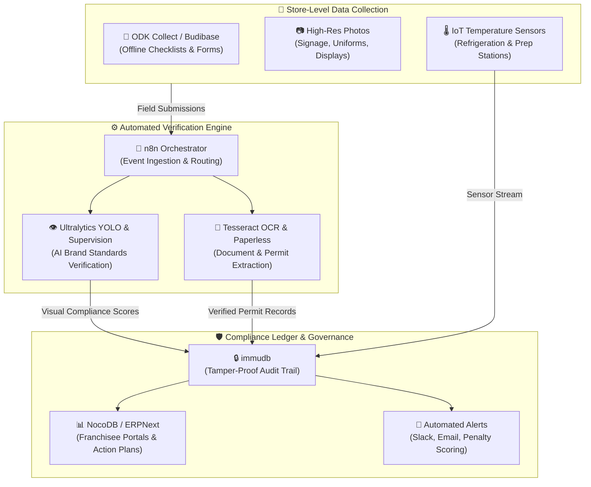

  

# 🏢 Awesome Automated Franchise Policy Audit Systems

  
  
  
  
  
  

---

## 🎯 Executive Overview & SEO Meta Summary

A comprehensive, production-tested index of **Automated Franchise Policy Audit Systems**, **multi-unit compliance automation platforms**, and **open-source audit infrastructure**. 

Franchisors, multi-unit franchisees, compliance directors, and operations executives operate in distributed environments where physical inspections are costly, intermittent, and vulnerable to human bias. Modern franchise audit solutions leverage **AI computer vision**, **digital inspection checklists**, **IoT wireless sensors**, and **tamper-proof evidence ledgers** to automate store-level brand standards enforcement, food safety adherence, POS menu compliance, and royalty auditing across hundreds or thousands of franchise units in real time.

> **Key Capabilities Covered:** Automated Store Inspections • AI-Powered Photo Verification • Brand Standards Enforcement • Tamper-Resistant Audit Ledgers • Food Safety & Temperature Automation • POS & Pricing Compliance • Offline Field Audits • SOP Adherence Monitoring.

---

## 📑 Table of Contents

- [📊 Sector Overview & Market Dynamics](#-sector-overview--market-dynamics)
- [🏢 SaaS & Hosted Commercial Platforms](#-saas--hosted-commercial-platforms)
- [💻 Open-Source Repositories & Frameworks](#-open-source-repositories--frameworks)
- [🏗️ Architectural Blueprint for Self-Hosted Systems](#️-architectural-blueprint-for-self-hosted-systems)
- [🤝 How to Contribute](#-how-to-contribute)
- [📈 Star History](#-star-history)
- [💖 Support & Sponsorship](#-support--sponsorship)
- [⚖️ Disclaimer](#️-disclaimer)

---

## 📊 Sector Overview & Market Dynamics

The global **Franchise Management & Compliance Audit Software** market is currently estimated at **$1.7 billion to $2.8 billion** (2024–2026), expanding at a compound annual growth rate (**CAGR) of 8.9% to 10.5%**, and is projected to cross **$5.0 billion+** over the next decade. 

### Market Concentration & Fragmentation Profile
* **Moderately to Highly Fragmented Ecosystem:** The market is not a single "winner-take-all" monopoly. Instead, it is characterized by deep vertical specialization across Quick-Service Restaurants (QSRs), automotive dealerships, hotel hospitality, convenience retail, and healthcare clinics.
* **Point Solution vs. Enterprise Core Split:** Operators frequently combine specialized point tools (e.g., IoT automated temperature probes and photo auditing AI) with broader enterprise franchise ERP suites.
* **Active Private Equity Consolidation:** High-growth platforms are actively being merged into unified ops platforms (e.g., Crunchtime's acquisition of Zenput, Serent Capital's backing of FranConnect, and Ladle's acquisition of MeazureUp), driving integration between daily employee task execution and central compliance governance.

---

## 🏢 SaaS & Hosted Commercial Platforms

The following enterprise platforms specialize in franchise audits, field inspections, photo compliance verification, and operational brand standard tracking. Sorted in **descending order by company scale** (estimated valuation or annual recurring revenue):

| Platform | Company Size (Valuation / Revenue) | Starting Tier Pricing | Free Tier / Trial Limits | Core Audit & Compliance Capabilities |
| :--- | :--- | :--- | :--- | :--- |
| **[SafetyCulture (iAuditor)](https://safetyculture.com/)** | **~$1.8B Valuation** ($2.7B AUD) / ~$120M+ ARR | **$24 / user / month** (Premium plan billed annually; $29/mo billed monthly) | **Free Forever Plan**: Up to 10 team members, up to 10 completed inspection checklists/month, photo uploads & PDF reports | Mobile inspection checklists, automated corrective actions, temperature sensor integrations, and store-level brand compliance audits for enterprise chains. |
| **[Zenput (Crunchtime)](https://www.crunchtime.com/)** | **~$800M Valuation** (Acquired by Crunchtime) / ~$25M ARR | **~$40 / location / month** (Operations Execution baseline tier) | **14-Day Guided Pilot**: No permanent free tier; structured 14-day proof-of-concept on request with custom checklist templates | Automated brand execution, photo/video integrity checks, QSR food safety verification, and automated escalation workflows across distributed stores. |
| **[FranConnect](https://www.franconnect.com/)** | **~$400M Valuation** (Serent Capital) / ~$70M ARR | **$250 / month** (Starting operational module tier; scales with location volume) | **0-Day Trial (Demo Only)**: No public free tier; personalized live product walkthrough and custom sandbox assessment | Complete franchise lifecycle suite, central brand standards repository, automated royalty tracking, field inspection scoring, and LMS integration. |
| **[FORM OpX (Form.com)](https://www.form.com/)** | **~$120M Valuation** (Diversis Capital) / ~$35M ARR | **$30 / user / month** (Essentials tier; minimum 10 users = $300/month baseline) | **0-Day Trial (Demo Only)**: No self-serve free plan; enterprise pilot program available upon qualified sales consultation | Offline-first mobile field audit forms, AI computer vision for photo verification, dynamic form logic, multi-lingual workflows (54 languages). |
| **[MarketMan](https://www.marketman.com/)** | **~$100M Valuation** (PSG backed / Meal Ticket) / ~$18M ARR | **$249 / location / month** (Starter plan billed annually; $279/mo billed monthly) | **0-Day Trial (Demo Only)**: No self-serve free tier; 1-on-1 scheduled live sandbox demonstration with custom recipe audit modeling | Multi-unit restaurant inventory audits, automated invoice OCR price variance alerts, commissary-to-store transfer tracking, and food waste checks. |
| **[ComplianceMetrix (CMX1)](https://www.compliancemetrix.com/)** | **~$80M Valuation** ($51M funding) / ~$13M ARR | **$1,000 / month** ($12,000/year minimum baseline enterprise subscription) | **0-Day Trial (Demo Only)**: No free tier; custom enterprise proof-of-concept and ROI assessment with sample audit templates | Enterprise quality and food safety compliance, offline field audits, vendor onboarding certifications, corrective action plans (CAPA), and lab test tracking. |
| **[Jolt](https://www.jolt.com/)** | **~$50M Valuation** (Acquired by Digi - $1.2B parent) / ~$19.7M ARR | **$50 / location / month** (Core checklists & digital temperature logs module) | **0-Day Trial (Demo Only)**: No free tier; customized live environment demo with remote temperature sensor demonstration | Digital food safety compliance, wireless Bluetooth temperature probe tracking with manual override detection, and brand completion audit reports. |
| **[IntouchCheck (Intouch)](https://www.intouchinsight.com/)** | **~$15M Market Cap** (TSXV: INX) / ~$18M USD ($25M CAD) Rev | **$39 / user / month** (Checklists & Inspection Standard tier) | **14-Day Free Trial**: Full inspection module access for up to 5 user accounts with custom checklist creation and photo uploads | Multi-location inspection software, rule-based approval routing, random spot-check auditor scheduling, and automated temperature monitoring. |
| **[MeazureUp](https://meazureup.com/)** | **~$10M Valuation** (Acquired by Ladle) / ~$2.4M ARR | **$20 / user / month** (AuditApp & DailyChex baseline license) | **7-Day Free Trial**: Full feature access to AuditApp and DailyChex, photo attachments, action plans, and digital scorecards | Real-time process control monitoring, district manager field inspection apps with photo evidence, timestamped logs, and franchisee transition scoring. |
| **[OpsAnalitica](https://www.opsanalitica.com/)** | **~$6M Valuation** (Bootstrapped / Private) / ~$1.5M ARR | **$30 / location / month** (Standard multi-unit operations subscription) | **Free Forever Plan**: 1 user, 1 location, single active checklist (e.g., food safety or daily opening checklist) with unlimited completions | AI-powered **OpsPhotoAnalyzer** acting as a 24/7 automated brand auditor, scanning checklist photos to verify uniforms, signage, and plating compliance. |
| **[FieldXpress (Subsidex)](https://play.google.com/store/apps/details?id=com.subsidex.fieldxpress)** | **~$5M Valuation** / ~$1.2M ARR | **$15 / user / month** (Field operations tracking standard tier) | **14-Day Free Trial**: Complete access for up to 10 field agents, route planning, store compliance checklists, and GPS location tracking | Mobile field inspection app, intelligent route planning, real-time field staff geotagging, SOP adherence tracking, and dealer audit logs. |

---

## 💻 Open-Source Repositories & Frameworks

Production-grade open-source repositories for self-hosting audit infrastructure, building field inspection apps, training computer vision compliance models, and maintaining tamper-proof audit trails. Sorted in **descending order by GitHub star count**:

- **[n8n](https://github.com/n8n-io/n8n)**   
  *Fair-code workflow automation platform for orchestrating franchise policy audits, routing non-compliance alerts, and connecting store data.*  
  Serves as the central integration bus for automated audits: triggers automated webhooks when store checklists fail, routes photo submissions to AI inference endpoints, generates Jira/Slack corrective action tickets for store managers, and dispatches escalation emails to district supervisors.

- **[Tesseract OCR](https://github.com/tesseract-ocr/tesseract)**   
  *The premier open-source Optical Character Recognition engine for automated scanning and digitization.*  
  Critical for converting legacy paper inspection logs, printed supplier invoices, health inspection certificates, and printed receipts from distributed franchise units into structured, queryable digital audit records.

- **[NocoDB](https://github.com/nocodb/nocodb)**   
  *Open-source smart spreadsheet and relational database interface connecting directly to PostgreSQL/MySQL.*  
  Provides franchise compliance directors with an instant Airtable-like collaborative workspace for tracking location checklists, managing recurring audit schedules, recording infraction penalties, and reviewing store performance scorecards.

- **[Ultralytics YOLO](https://github.com/ultralytics/ultralytics)**   
  *State-of-the-art computer vision framework (YOLOv8 / YOLO11) for real-time object detection and visual audit automation.*  
  Enables automated visual verification of franchise brand standards: detects proper staff uniform and hat adherence, verifies marketing signage and point-of-sale poster placements, audits kitchen cleanliness, and validates product plating compliance from submitted field photos.

- **[Odoo](https://github.com/odoo/odoo)**   
  *Comprehensive open-source business management suite (LGPL-3.0).*  
  Features modular **Field Service**, **Quality Control**, and **Point of Sale (POS)** engines. Provides multi-branch inventory tracking, automated quality checkpoints, scheduled maintenance audits, and standardized operating procedure enforcement across distributed franchise branches.

- **[Supervision](https://github.com/roboflow/supervision)**   
  *Reusable open-source computer vision utilities for retail shelf audits, zone detection, and compliance analysis.*  
  Streamlines video stream and photo analysis for retail and restaurant audits: provides polygon zone monitoring (e.g. verifying clean food prep counters), object counting (detecting inventory stockouts), and visual compliance annotators.

- **[Paperless-ngx](https://github.com/paperless-ngx/paperless-ngx)**   
  *Open-source document management system that transforms physical documents into searchable digital archives.*  
  Features automated OCR, document classification, and metadata extraction. Ideal for centralizing franchise agreements, local health inspection reports, food safety certificates, and business licenses across hundreds of locations.

- **[ERPNext](https://github.com/frappe/erpnext)**   
  *100% open-source enterprise ERP (GPL-3.0) with robust multi-company franchise operations support.*  
  Offers native modules for asset maintenance inspections, quality inspection forms, multi-unit accounting, royalty calculation ledgers, and consolidated corporate reporting across franchisor-franchisee boundaries.

- **[Budibase](https://github.com/Budibase/budibase)**   
  *Open-source low-code platform for building internal tools, auditor portals, and mobile field inspection apps.*  
  Enables operations teams to generate custom mobile-responsive store audit apps in hours—featuring photo attachments, digital signature capture, dynamic conditional fields, and role-based access for field auditors and franchisees.

- **[immudb](https://github.com/codenotary/immudb)**   
  *Lightweight, high-speed immutable database for cryptographic, tamper-proof audit trails and compliance ledgers.*  
  Ensures that once a store inspection, temperature log, or violation notice is recorded, it cannot be retroactively altered, backdated, or falsified by store managers or operators—providing legally admissible proof of compliance posture.

- **[OpenBoxes](https://github.com/openboxes/openboxes)**   
  *Open-source supply chain and inventory management software (EPL-1.0).*  
  Specialized for tracking inventory movement, lot numbers, expiration dates, and multi-location transfers across distributed franchise distribution centers and commissary kitchens.

- **[ODK Collect](https://github.com/getodk/collect)**   
  *The global open-source mobile standard for offline field data collection and site inspections.*  
  Features robust offline caching, GPS location verification, time-stamped photo capture, dynamic question skipping, and automated synchronization once network connectivity is restored—essential for field auditors visiting remote stores.

- **[getsear Franchise Module](https://github.com/AIVIIZN/getsear)**   
  *Open-source franchise management specification with API routes, compliance check schemas, and royalty models.*  
  Defines structured database schemas for `franchise_compliance_checks` (menu adherence, pricing compliance, operational hours), corporate menu push status logs (`menu_push_log`), regional director assignments, and automated period-based royalty calculations.

- **[Crop Compliance Observation Ledger](https://github.com/mizcausevic-dev/crop-compliance-observation-ledger)**   
  *TypeScript control plane for field observations, evidence blockers, and audit posture verification.*  
  Demonstrates an evidence-ledger architecture that converts observation data into governed review lanes, named compliance ownership, and automated verification posture endpoints with 100% test coverage.

---

## 🏗️ Architectural Blueprint for Self-Hosted Systems

Franchise networks can build a vendor-independent, enterprise-grade automated audit platform by orchestrating these complementary open-source components:

1. **Edge Inspection Capture**: Field reps and store managers capture geotagged checklists via **ODK Collect** or custom **Budibase** apps.
2. **AI Visual & OCR Verification**: Photo submissions are routed by **n8n** to **Ultralytics YOLO** (detecting uniforms, signage, plating) and **Tesseract OCR** (verifying invoices and health inspection certificates).
3. **Cryptographic Immutability**: All inspection scores, sensor streams, and compliance timestamps are permanently committed to an **immudb** ledger to prevent post-incident falsification.
4. **Resolution Management**: Non-compliance triggers corrective action tasks in **ERPNext** or **NocoDB**, with automated escalation to regional franchise directors.

---

## 🤝 How to Contribute

Contributions from franchise operators, compliance auditors, and open-source developers are welcome!

1. 🍴 **Fork the repository** on GitHub.
2. 🌿 **Create a feature branch**: `git checkout -b feature/add-new-audit-platform`.
3. 📝 **Add or update an entry**: Maintain tabular pricing specifications for SaaS tools, or provide shields.io star badges linking to the repository stargazers page for open-source projects.
4. 🚀 **Commit your changes**: `git commit -m "feat: add NewAuditPlatform to ecosystem"`.
5. 📬 **Submit a Pull Request**: Provide a concise summary of the software and links to official documentation.

---

## 📈 Star History

---

## 💖 Support & Sponsorship

Thank you for exploring and building with the **Automated Franchise Policy Audit Systems** ecosystem! If this curated guide assisted your team in evaluating franchise compliance platforms, deploying automated inspection checklists, or designing an open-source audit ledger:

- ⭐ **Star this repository** to improve discoverability for multi-unit operators and software engineers.
- 🍴 **Fork and share** with your franchise operations, QA, and IT engineering teams.
- ☕ **Sponsor the Maintainer**: Support ongoing curation, research, and open-source maintenance via the [GitHub Sponsors Dashboard](https://github.com/sponsors/ishandutta2007).

---

## ⚖️ Disclaimer

* This repository is a community-curated research directory and does not constitute formal legal, franchise disclosure (FDD), or regulatory compliance advice.
* All trademarks, product names, logos, and registered brands belong to their respective corporate owners.
* Self-hosted audit infrastructure handling employee records, CCTV footage, or store metrics must comply with local privacy regulations (GDPR, CCPA, BIPA) and franchise contract disclosure standards.
* Photo-based and computer-vision audit models require representative training datasets to accurately reflect brand-specific plating, uniform, and signage guidelines.
